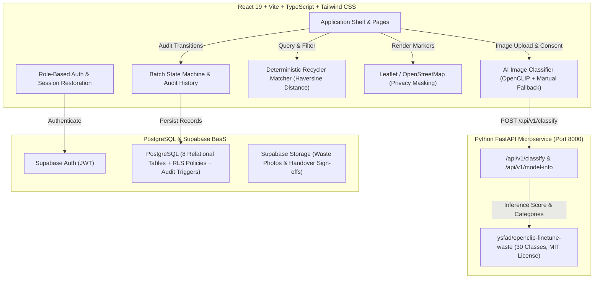

# WasteRoute — Circular Waste Logistics & Recycler Matchmaking Platform

**WasteRoute** is an end-to-end circular economy coordination web application that helps waste generators (societies, campuses, commercial buildings) inspect recyclable waste batches using AI vision, discover verified compatible recyclers based on deterministic quality criteria, and track material through logistics collection and verified recycler handover.

---

## 1. System Architecture



---

## 2. Core Features & Capabilities

- **Multi-Role RBAC:** 4 distinct user roles: `generator`, `collector`, `recycler`, and `admin`. Users cannot elevate their own privileges or self-assign admin status.
- **AI-Assisted Image Inspection:** Analyzes waste photographs against 30 categories (`plastic_water_bottles`, `cardboard_boxes`, `aluminum_cans`, etc.) powered by `ysfad/openclip-finetune-waste` (MIT). Honest, uncalibrated similarity scores with mandatory user consent and immediate manual category correction dropdown.
- **Deterministic Recycler Matching Engine:** Evaluates material compatibility, excludes unverified facilities, tests contamination thresholds, volume capacities, and ranks by Haversine distance with transparent match diagnostics.
- **Auditable Status Timeline:** Strict state machine transitions (`available` &rarr; `collection_requested` &rarr; `assigned` &rarr; `picked_up` &rarr; `delivered` &rarr; `confirmed`) with immutable PostgreSQL audit log tracking actor, role, timestamp, and notes.
- **Interactive Geospatial Maps:** OpenStreetMap tiles via Leaflet with address privacy protection for waste generators.
- **Admin Verification Desk:** Dedicated KYC portal for reviewing and approving recycler facility licenses with audit logging and operational reports.

---

## 3. Prerequisites

- **Node.js:** v18.0.0 or newer (tested on `v24.20.0`)
- **npm:** v9.0.0 or newer (tested on `11.19.0`)
- **Python:** 3.10 to 3.14 (tested on `3.14.4`)
- **Git**

---

## 4. Local Quick Start & Running Commands

### Step 1: Clone & Environment Setup
```bash
git clone <your-repo-url>
cd wasteroute
```

### Step 2: Start the Python FastAPI AI Service
In terminal 1:
```bash
cd ai-service
pip install -r requirements.txt
python -m uvicorn app.main:app --host 0.0.0.0 --port 8000 --reload
```
*Health check URL: `http://localhost:8000/health`*  
*Model metadata: `http://localhost:8000/api/v1/model-info`*

### Step 3: Start the Frontend Application
In terminal 2:
```bash
cd frontend
npm install
npm run dev
```
*The web application is now live at `http://localhost:5173`.*

---

## 5. Running Automated Test Suites

### Frontend Vitest Tests
```bash
cd frontend
npm run test
```
*Executes 19 unit tests covering:*
- Haversine coordinate distance calculation
- Deterministic matching engine (verification gate, material matching, contamination ceiling, quantity constraints, score ranking)
- State machine role transitions and idempotency checks
- Batch listing form input validation

### Frontend Production Build Verification
```bash
cd frontend
npm run build
```
*Verifies strict TypeScript compilation and Vite production bundle generation (`dist/`).*

### AI Service Pytest Tests
```bash
cd ai-service
python -m pytest tests/
```
*Executes 5 backend tests verifying:*
- Service health check
- Model info and 30-class metadata
- Mandatory user consent enforcement (rejects without consent)
- Invalid MIME type rejection
- Image classification and category mapping

---

## 6. Supabase Database Configuration & Migrations

If connecting to a live Supabase project:
1. Create a new project in the [Supabase Dashboard](https://supabase.com).
2. Go to **SQL Editor** and run the migration files in order from `backend/migrations/`:
   - `001_initial_schema.sql` (Creates enums, tables, indexes)
   - `002_rls_policies.sql` (Enables RLS and explicit least-privilege policies)
   - `003_audit_triggers.sql` (Auth sync, immutability, and state-machine logger)
   - `004_seed_demo_data.sql` (Clearly labeled fictional seed dataset)
3. Create Storage Buckets in Supabase:
   - `waste-images` (for listing photographs)
   - `handover-evidence` (for collection and delivery proof)
4. Copy `frontend/.env.example` to `frontend/.env` and update `VITE_SUPABASE_URL` and `VITE_SUPABASE_ANON_KEY`.

> **Offline / Demo Resilience:** If Supabase keys are not configured or the network is unavailable, WasteRoute automatically activates its built-in local persistent storage layer with seed data so that the entire demonstration works seamlessly out of the box.

---

## 7. How to Create the First Admin Account

Admin permissions cannot be self-selected during public registration. To securely elevate the first admin:
1. Register a user via the registration page (e.g. `admin@yourdomain.com`).
2. Run this query in the **Supabase SQL Editor**:
```sql
UPDATE public.profiles
SET role = 'admin'
WHERE email = 'admin@yourdomain.com';
```

---

## 8. AI Model Details & Limitations

- **Candidate Model:** `ysfad/openclip-finetune-waste` on Hugging Face Hub.
- **License:** MIT License.
- **Architecture:** OpenCLIP ViT-B-16 pretrained on `laion2b_s34b_b88k` and fine-tuned on the Recyclable and Household Waste Classification Dataset (~91.3% validation accuracy).
- **Supported Waste Taxonomy (30 Classes):**
  - *Plastics:* `plastic_water_bottles`, `plastic_soda_bottles`, `plastic_detergent_bottles`, `plastic_food_containers`, `disposable_plastic_cutlery`, `plastic_shopping_bags`, `plastic_trash_bags`, `plastic_straws`, `plastic_cup_lids`, `styrofoam_cups`, `styrofoam_food_containers`
  - *Paper & Cardboard:* `cardboard_boxes`, `cardboard_packaging`, `office_paper`, `newspaper`, `magazines`, `paper_cups`
  - *Metals:* `aluminum_soda_cans`, `aluminum_food_cans`, `steel_food_cans`, `aerosol_cans`
  - *Glass:* `glass_beverage_bottles`, `glass_food_jars`, `glass_cosmetic_containers`
  - *Organics & Textiles:* `food_waste`, `coffee_grounds`, `eggshells`, `tea_bags`, `clothing`, `shoes`
- **Important Ethical Disclosures & Limitations:**
  - Raw similarity scores are not calibrated probabilities.
  - Computer vision cannot verify resin chemical purity, hazardous chemical residues, or facility-specific sorting criteria.
  - The UI presents suggestions with a mandatory manual confirmation/correction dropdown.
  - If the Python service is offline, a client-side heuristic fallback provides seamless continuity.

---

## 9. Complete Hackathon Demo Walkthrough Script

Follow these steps for a live presentation of the complete lifecycle:

1. **Explore the Landing Page (`/`):**
   - Review the problem statement, 4-step circular flow diagram, and stakeholder ecosystem.
2. **Switch to Generator Persona:**
   - Click the top navigation demo pill: **`generator`** (Palm Grove Housing Society).
   - Go to **Dashboard** &rarr; see existing listings (PET Plastic Bottles, Cardboard Boxes).
3. **Create a New Waste Listing (`/create-batch`):**
   - Click **New Listing**.
   - Upload any sample waste image (e.g. a plastic bottle or can photo).
   - Check the **Consent Checkbox** and click **Analyze Waste Photograph**.
   - See the AI detection card display candidate class, raw similarity score, and category.
   - Adjust quantity (e.g. `60 kg`), set contamination to `6%`, and click **Publish & Find Recyclers**.
4. **Deterministic Recycler Matching (`/batch/:id/match`):**
   - The matching engine calculates Haversine distance and checks facility acceptance rules.
   - Verified facilities like **EcoPlast Circular Hub** display a high compatibility score (~89%) with criteria met listed in green.
   - Disqualified facilities explain why (e.g. *“Does not accept plastic”* or *“Pending admin KYC”*).
   - Click **Request Collection Pickup** &rarr; status updates to `collection_requested`.
5. **Switch to Collector Persona:**
   - Click the top navigation demo pill: **`collector`** (Ravi Logistics).
   - Go to **Dashboard** &rarr; see the requested dispatch under *Dispatches Awaiting Pickup*.
   - Click **Accept Pickup Job** &rarr; batch moves to `assigned`.
   - Under *Active Logistics Jobs*, click **Confirm Physical Pickup** &rarr; status becomes `picked_up`.
   - Click **Confirm Gate Delivery** &rarr; status becomes `delivered`.
6. **Switch to Recycler Persona:**
   - Click the top navigation demo pill: **`recycler`** (EcoPlast Circular Hub).
   - Go to **Dashboard** &rarr; see the delivery waiting at the gate under *Incoming Gate Deliveries*.
   - Click **Inspect & Sign-off Handover**.
   - Enter verified weight (e.g. `58.5 kg`), confirm quality acceptance, and click **Certify Handover**.
   - Batch status officially updates to **`confirmed`**!
7. **Verify the Immutable Audit Timeline (`/batch/:id`):**
   - View the batch detail page &rarr; see the chronological timeline documenting every single transition with timestamp, actor, and role.
8. **Explore the Map View (`/map`):**
   - View Leaflet map with OpenStreetMap tiles displaying verified recyclers and protected batch locations with privacy masking.
9. **Switch to Admin Persona (`/admin`):**
   - Click the top navigation demo pill: **`admin`**.
   - Review pending recycler applications (e.g. Apex Polymers), review registration documents, and click **Approve & Certify Recycler**.

---

## 10. Verification & Release Report

| Component / Stage | Status | Verification Evidence |
|---|---|---|
| **Stage 1: Architecture & Planning** | **VERIFIED (PASS)** | Complete specification in `wasteroute_architecture_plan.md` |
| **Stage 2: Project Shell & Routing** | **VERIFIED (PASS)** | React 19 + Vite + TS + Tailwind CSS built cleanly (`dist/`) |
| **Stage 3: Database & Security** | **VERIFIED (PASS)** | 4 versioned SQL migrations (`001` - `004`), RLS policies, audit triggers |
| **Stage 4: Auth & Protected Routes** | **VERIFIED (PASS)** | Supabase Auth + Session restoration + 1-click persona switcher |
| **Stage 5: Waste Batch Listings** | **VERIFIED (PASS)** | Form validations, geocoding, status transitions verified |
| **Stage 6: Recycler Matching Engine** | **VERIFIED (PASS)** | 8 Vitest unit tests passed (`src/tests/matchingEngine.test.ts`) |
| **Stage 7: AI Image Classification** | **VERIFIED (PASS)** | 5 Pytest tests passed (`ai-service/tests/test_ai_service.py`), OpenCLIP ViT-B-16 mapping + manual fallback |
| **Stage 8: State Machine & Handover** | **VERIFIED (PASS)** | 7 Vitest unit tests passed (`src/tests/stateMachine.test.ts`), gate sign-off modal working |
| **Stage 9: Leaflet & Geospatial Maps** | **VERIFIED (PASS)** | OSM tiles, marker popups, address privacy masking implemented |
| **Stage 10: Admin Verification Desk** | **VERIFIED (PASS)** | Recycler KYC queue, approval/rejection audit logging, query-backed metrics |
| **Stage 11: Production Build** | **VERIFIED (PASS)** | `npm run build` completed in 8.29s with 0 errors |
